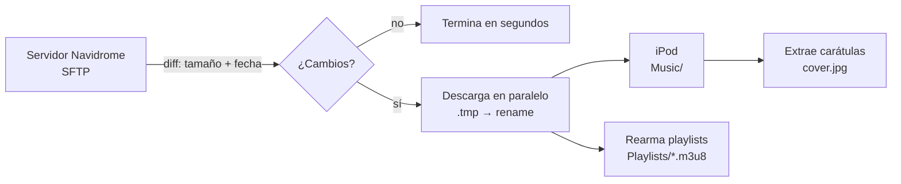

<div align="center">

# 🎵 IpodSync

**Sincronizá tu biblioteca de música de Navidrome a un iPod Classic con Rockbox, por SSH/SFTP.**

Sin WSL, sin scripts de rsync, sin copiar archivos a mano. Conectás el iPod, apretás Sincronizar.

[](#instalación)
[](https://dotnet.microsoft.com/download/dotnet/8.0)
[](#correr-los-tests)
[](LICENSE)
[](../../releases)

[English](README.md) · **Español**

</div>

---

## Índice

- [Qué hace](#qué-hace)
- [Funciones](#funciones)
- [Cómo funciona](#cómo-funciona)
- [Requisitos](#requisitos)
- [Instalación](#instalación)
  - [Windows](#windows)
  - [Linux](#linux)
- [Primer uso](#primer-uso)
- [Sincronización](#sincronización)
- [Playlists](#playlists)
- [Carátulas](#carátulas)
- [Browser de biblioteca](#browser-de-biblioteca)
- [Automatización](#automatización)
- [Seguridad](#seguridad)
- [Solución de problemas](#solución-de-problemas)
- [Compilar desde el código fuente](#compilar-desde-el-código-fuente)
- [Licencia](#licencia)

---

## Qué hace

IpodSync mantiene un iPod Classic con [Rockbox](https://www.rockbox.org/) sincronizado con
una biblioteca de música servida por [Navidrome](https://www.navidrome.org/) (o cualquier
carpeta de audio accesible por SSH). Solo copia lo que cambió, rearma tus playlists en el
formato que Rockbox entiende, y extrae las carátulas para que Rockbox pueda mostrarlas.

Reemplaza un setup viejo de PowerShell + WSL + rsync por una única app de escritorio
autocontenida para **Windows** y **Linux**, disponible en **español e inglés** (cambiable
en vivo desde la propia app).

## Funciones

| | |
|---|---|
| 🔌 **Cualquier servidor SFTP** | Autenticación por contraseña o clave SSH (con passphrase opcional), con una prueba de conexión real antes de guardar |
| ⚡ **Sincronización incremental** | Compara tamaño + fecha de modificación y solo transfiere lo nuevo o cambiado. Si no hay cambios, termina en segundos sin tocar el iPod |
| 🚀 **Transferencias en paralelo** | Hasta 3 archivos a la vez, cada uno con su propia conexión SFTP |
| 🛡️ **Escritura a prueba de cuelgues** | Descarga a un archivo `.tmp`, verifica el tamaño, y recién ahí renombra de forma atómica. Una sync cancelada o interrumpida nunca deja un archivo truncado |
| 📃 **Traducción de playlists** | Convierte las playlists del servidor a las rutas absolutas que espera el Playlist Catalogue de Rockbox |
| 🖼️ **Carátulas** | Extrae las carátulas embebidas a archivos `cover.jpg` que Rockbox puede leer |
| 📚 **Browser de biblioteca** | Navegá lo que ya está en el iPod por álbum o canción, en lista o grilla, totalmente offline |
| 🤖 **Automatización** | Auto-sync al conectar, ícono de bandeja, arranque con la sesión |
| 🌐 **Bilingüe** | Español e inglés, cambiable sin reiniciar |

## Cómo funciona



1. **Detecta** el iPod buscando una carpeta `.rockbox` en la raíz de cualquier unidad
   montada (nunca por letra de unidad, que cambia entre sesiones).
2. **Compara** el servidor contra el iPod, clasificando cada archivo como *nuevo*,
   *actualizado*, *borrado* o *sin cambios*. Las fechas usan una tolerancia de ±2 segundos
   por la resolución de FAT32.
3. **Transfiere** los cambios en paralelo. Un archivo que falla se reporta pero no aborta
   el resto del lote.
4. **Limpia** los archivos que ya no existen en el servidor (opcional, ver
   [Seguridad](#seguridad)).
5. **Rearma** las playlists y **extrae** las carátulas.

## Requisitos

- **Un iPod** con [Rockbox](https://www.rockbox.org/) instalado, conectado por USB
- **Un servidor** accesible por SSH/SFTP con tu biblioteca de música (Navidrome o
  cualquier otro setup — la app solo necesita acceso SSH y una carpeta con archivos de
  audio)
- **Windows 10 o superior**, o un **escritorio Linux** (x64)

No hace falta instalar .NET: los releases son autocontenidos.

---

## Instalación

Bajá la última versión desde la **[página de Releases](../../releases)**.

### Windows

#### Opción A — Instalador (recomendado)

1. Bajá **`IpodSync-Setup-X.X.X.exe`**.
2. Corrélo. No pide permisos de administrador; se instala solo para tu usuario.
3. Si Windows SmartScreen muestra una advertencia ("Windows protegió tu PC"), hacé clic en
   **Más información → Ejecutar de todas formas**.
4. Abrí **IpodSync** desde el menú Inicio.

El instalador agrega un acceso directo al menú Inicio y un desinstalador normal
(*Configuración → Aplicaciones → Aplicaciones instaladas → IpodSync → Desinstalar*).

#### Opción B — Portable

1. Bajá **`IpodSync-windows-x64.zip`**.
2. Descomprimilo en cualquier carpeta (por ejemplo `C:\Tools\IpodSync`).
3. Corré **`IpodSync.exe`**.

Para sacarlo, borrá la carpeta. Si activaste *Arrancar con Windows*, apagalo primero en la
configuración de la app para que se limpie la entrada de arranque.

### Linux

1. Bajá **`IpodSync-linux-x64.zip`** y descomprimilo:

   ```bash
   mkdir -p ~/Applications/IpodSync
   unzip IpodSync-linux-x64.zip -d ~/Applications/IpodSync
   cd ~/Applications/IpodSync
   ```

2. Dale permiso de ejecución y corrélo:

   ```bash
   chmod +x IpodSync
   ./IpodSync
   ```

3. **Opcional — integración al menú de aplicaciones.** Para agregar IpodSync al menú de
   aplicaciones de tu escritorio, con ícono, corré esto desde la misma carpeta:

   ```bash
   mkdir -p ~/.local/share/applications ~/.local/share/icons/hicolor
   sed "s|^Exec=.*|Exec=$PWD/IpodSync|" packaging-linux/ipodsync.desktop \
     > ~/.local/share/applications/ipodsync.desktop
   cp -r packaging-linux/hicolor/* ~/.local/share/icons/hicolor/
   ```

#### Notas de Linux

- **Montaje:** IpodSync busca el iPod entre las unidades montadas, así que tiene que estar
  montado con acceso de escritura para tu usuario. La mayoría de los entornos de escritorio
  (GNOME, KDE, XFCE, …) lo hacen solos al conectarlo. En un setup mínimo, montalo a mano o
  usá `udisksctl mount -b /dev/sdX2`.
- **Ícono de bandeja:** en GNOME puede hacer falta la extensión *AppIndicator and
  KStatusNotifierItem Support*. Sin ella la app funciona igual; solo no se ve el ícono de
  bandeja.
- **Desinstalar:** borrá la carpeta, más el archivo `.desktop` que hayas creado durante la
  integración al menú, si corresponde. Si activaste *arranque con la sesión*, desactivalo
  primero desde la app (vive en `~/.config/autostart/`).

---

## Primer uso

En el primer arranque, IpodSync pide los datos de tu servidor:

| Campo | Descripción |
|---|---|
| **Host / Puerto** | La dirección de tu servidor y el puerto SSH (normalmente `22`) |
| **Usuario** | Usuario SSH |
| **Autenticación** | Contraseña, o clave privada SSH (con passphrase opcional) |
| **Carpeta remota** | Ruta a tu biblioteca de música en el servidor, por ejemplo `/srv/music` |

Hacé clic en **Probar conexión** antes de guardar: hace un login real y verifica que la
carpeta remota exista.

> 🔐 **Sobre las credenciales guardadas.** Las contraseñas y passphrases nunca se guardan
> en texto plano. En Windows se cifran con **DPAPI**, atadas a tu usuario de Windows. En
> Linux se ofuscan con una clave derivada de tu usuario y máquina, que protege contra una
> lectura casual del archivo de configuración pero no equivale a un keyring del sistema.
> Para el setup más seguro en Linux, preferí **autenticación por clave SSH**.

## Sincronización

1. **Poné el iPod en Modo Disco de Apple**: apagalo, y prendelo manteniendo
   **SELECT + PLAY**. *Nunca sincronices con Rockbox corriendo* (ver [Seguridad](#seguridad)).
2. Conectalo por USB. IpodSync lo detecta solo.
3. Hacé clic en **Sincronizar**. El progreso se muestra por archivo; podés **cancelar en
   cualquier momento** sin dejar archivos corruptos.
4. Al terminar, **expulsá el iPod desde tu sistema** antes de desconectarlo.

Si no hay nada nuevo en el servidor, el pre-check termina la sync en segundos sin escribir
nada en el iPod.

## Playlists

IpodSync lee las playlists del servidor (rutas relativas a tu biblioteca, como las escriben
herramientas como TideKeeper) y las traduce a rutas absolutas que Rockbox entiende.

- Las playlists se escriben en `/Playlists/*.m3u8` en el iPod, así aparecen en el
  **Playlist Catalogue** de Rockbox.
- Las entradas rotas (canciones que ya no están) se sacan.
- Las playlists generadas en corridas anteriores que ya no existen en el servidor se
  borran.
- **Las playlists que grabás a mano en el iPod nunca se tocan.**
- Los `.m3u` de origen no se copian al dispositivo; el estado de la sync vive en
  `.ipod-sync-state.json` en la raíz del iPod.

## Carátulas

Rockbox no puede leer las carátulas embebidas en los tags de audio. IpodSync las extrae y
escribe un `cover.jpg` en cada carpeta de álbum, redimensionado a 500 px y guardado como
**JPEG baseline** (Rockbox no soporta JPEG progresivo).

Esto corre automáticamente después de cada sync, y también se puede disparar a pedido
desde el browser de biblioteca.

## Browser de biblioteca

Una vista de solo lectura de lo que **ya está en el iPod**. No toca el servidor ni la red,
así que funciona offline.

- Vista de **Álbumes** o **Canciones**
- Diseño de **Lista** o **Grilla**
- Las carátulas se cachean en memoria para un scroll fluido

## Automatización

Todo opcional, todo configurable desde el panel de settings:

- **Auto-sync al conectar** — arranca una sync apenas se detecta el iPod
- **Bandeja del sistema** — cerrar la ventana la minimiza a la bandeja (*Abrir /
  Sincronizar / Salir*)
- **Arranque con la sesión** — clave `Run` del registro en Windows, entrada en
  `~/.config/autostart` en Linux
- **Guardia de instancia única** — nunca pueden correr dos syncs sobre el mismo iPod a la
  vez

---

## Seguridad

IpodSync escribe y borra en el sistema de archivos de tu iPod. Por favor, leé esto.

> ⚠️ **Conectá siempre en Modo Disco de Apple, nunca con Rockbox corriendo.** Una
> escritura en el sistema de archivos durante un cuelgue de Rockbox es cómo se corrompen
> los iPods.

> ⚠️ **Expulsá siempre antes de desconectar.**

> ⚠️ **El borrado espeja el servidor por default.** Todo lo que esté bajo `Music/` en el
> iPod y ya no esté en el servidor se borra. Si tenés música en el iPod que no viene de
> esta biblioteca, apagá **"Borrar del iPod lo que ya no está en el servidor"** en la
> ventana principal antes de sincronizar.

Protecciones incorporadas:

- El borrado está **restringido a `Music/` y `Playlists/`**, nada más en el dispositivo
  se puede borrar.
- Los borrados requieren **confirmación** salvo que la desactives explícitamente.
- Todas las descargas pasan por un archivo temporal + rename atómico, con verificación de
  tamaño.

## Solución de problemas

<details>
<summary><b>No detecta el iPod</b></summary>

- Verificá que esté en **Modo Disco de Apple** (SELECT + PLAY al prenderlo), no corriendo
  Rockbox.
- Verificá que aparezca como unidad en tu explorador de archivos.
- Verificá que exista una carpeta `.rockbox` en la raíz de la unidad; así es como
  IpodSync lo reconoce.
- **Linux:** verificá que la unidad esté montada y sea escribible por tu usuario.
</details>

<details>
<summary><b>Falla la prueba de conexión</b></summary>

- Confirmá que podés conectarte con un cliente SSH normal: `ssh -p PUERTO usuario@host`.
- Verificá que la ruta de la carpeta remota exista y sea legible por ese usuario.
- Para autenticación por clave, verificá que el archivo de clave esté en un formato
  soportado y que la passphrase sea correcta.
</details>

<details>
<summary><b>Se recopian todos los archivos en cada sync</b></summary>

Generalmente significa que las fechas difieren en más de la tolerancia de 2 segundos de
FAT32, por ejemplo por un desfasaje de zona horaria o porque algo tocó los archivos en el
servidor. Verificá que el servidor no esté reescribiendo las fechas de modificación.
</details>

<details>
<summary><b>Las carátulas no aparecen en Rockbox</b></summary>

- Corré la extracción de carátulas desde el browser de biblioteca.
- Verificá que los archivos de audio del álbum tengan carátula embebida.
- Revisá la configuración de carátulas de Rockbox en *Settings → Theme Settings*.
</details>

<details>
<summary><b>No aparece el ícono de bandeja en Linux</b></summary>

En GNOME, instalá la extensión *AppIndicator and KStatusNotifierItem Support*. La app
funciona sin ella; solo falta el ícono de bandeja.
</details>

---

## Compilar desde el código fuente

Necesita el [SDK de .NET 8](https://dotnet.microsoft.com/download/dotnet/8.0).

```bash
git clone https://github.com/Ineuspiller/Ipod-Sync.git
cd Ipod-Sync/IpodSync
dotnet run --project IpodSync.Desktop
```

### Correr los tests

154 tests automatizados que cubren el motor de diff, el manejo de FAT32, las reglas de
borrado, las playlists, la persistencia, y tests de UI headless con Avalonia. No necesitan
servidor ni dispositivo:

```bash
dotnet test
```

### CLI headless

`IpodSync.Cli` corre todo el motor (diff, sync, playlists, covers) sin UI ni pantalla,
útil para desarrollo y testing.

```bash
dotnet run --project IpodSync.Cli
```

### Stack técnico

- [.NET 8](https://dotnet.microsoft.com/) + [Avalonia UI](https://avaloniaui.net/) — UI de escritorio multiplataforma
- [SSH.NET](https://github.com/sshnet/SSH.NET) — cliente SFTP
- [TagLibSharp](https://github.com/mono/taglib-sharp) — lectura de carátulas embebidas
- [SkiaSharp](https://github.com/mono/SkiaSharp) — redimensionado y codificación de carátulas

---

## Licencia

Publicado bajo la [Licencia MIT](LICENSE).
