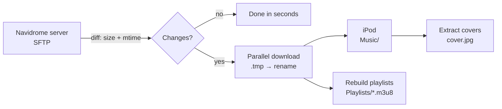

<div align="center">

# 🎵 IpodSync

**Sync your Navidrome music library to an iPod Classic running Rockbox, over SSH/SFTP.**

[](#installation)
[](https://dotnet.microsoft.com/download/dotnet/8.0)
[](#running-the-tests)
[](LICENSE)
[](../../releases)

**English** · [Español](README.es.md)

</div>

---

## Table of contents

- [What it does](#what-it-does)
- [Features](#features)
- [How it works](#how-it-works)
- [Requirements](#requirements)
- [Installation](#installation)
  - [Windows](#windows)
  - [Linux](#linux)
- [First run](#first-run)
- [Syncing](#syncing)
- [Playlists](#playlists)
- [Album art](#album-art)
- [Library browser](#library-browser)
- [Automation](#automation)
- [Safety](#safety)
- [Troubleshooting](#troubleshooting)
- [Building from source](#building-from-source)
- [License](#license)

---

## What it does

IpodSync keeps an iPod Classic running [Rockbox](https://www.rockbox.org/) in sync with a
music library served by [Navidrome](https://www.navidrome.org/) (or any folder of audio
files reachable over SSH). It only copies what changed, rebuilds your playlists in the
format Rockbox understands, and extracts album art so Rockbox can actually display it.

## Features

| | |
|---|---|
| 🔌 **Any SFTP server** | Password or SSH key auth (with optional passphrase), with a real connection test before saving |
| ⚡ **Incremental sync** | Compares size + modification time and only transfers what's new or changed. If nothing changed, it finishes in seconds without touching the iPod |
| 🚀 **Parallel transfers** | Up to 3 files at once, each on its own SFTP connection |
| 🛡️ **Crash-safe writes** | Downloads to a `.tmp` file, verifies the size, then renames atomically. A cancelled or interrupted sync never leaves a truncated file |
| 📃 **Playlist translation** | Converts server-side playlists into the absolute paths Rockbox's Playlist Catalogue expects |
| 🖼️ **Album art** | Extracts embedded covers into `cover.jpg` files Rockbox can read |
| 📚 **Library browser** | Browse what's already on the iPod by album or song, list or grid view, fully offline |
| 🤖 **Automation** | Auto-sync on connect, system tray icon, start with your session |
| 🌐 **Bilingual** | English and Spanish, switchable without restarting |

## How it works



1. **Detect** the iPod by looking for a `.rockbox` folder at the root of any mounted drive
   (never by drive letter, which changes between sessions).
2. **Diff** the server against the iPod, classifying every file as *new*, *updated*,
   *deleted*, or *unchanged*. Timestamps use a ±2 second tolerance to account for FAT32's
   2-second resolution.
3. **Transfer** the changes in parallel. A single failing file is reported but doesn't
   abort the rest of the batch.
4. **Clean up** files that no longer exist on the server (optional, see [Safety](#safety)).
5. **Rebuild** playlists and **extract** album art.

## Requirements

- **An iPod** with [Rockbox](https://www.rockbox.org/) installed, connected over USB
- **A server** reachable over SSH/SFTP with your music library on it (Navidrome or any
  other setup — the app only needs SSH access and a folder full of audio files)
- **Windows 10 or later**, or a **Linux desktop** (x64)

No .NET installation is needed: releases are self-contained.

---

## Installation

Download the latest version from the **[Releases page](../../releases)**.

### Windows

#### Option A — Installer (recommended)

1. Download **`IpodSync-Setup-X.X.X.exe`**.
2. Run it. No administrator rights are required; it installs for your user only.
3. If Windows SmartScreen shows a warning ("Windows protected your PC"), click
   **More info → Run anyway**.
4. Launch **IpodSync** from the Start Menu.

The installer adds a Start Menu shortcut and a regular uninstaller
(*Settings → Apps → Installed apps → IpodSync → Uninstall*).

#### Option B — Portable

1. Download **`IpodSync-windows-x64.zip`**.
2. Extract it to any folder (e.g. `C:\Tools\IpodSync`).
3. Run **`IpodSync.exe`**.

To remove it, delete the folder. If you enabled *Start with Windows*, turn it off in the
app's settings first so the startup entry is cleaned up.

### Linux

1. Download **`IpodSync-linux-x64.zip`** and extract it:

   ```bash
   mkdir -p ~/Applications/IpodSync
   unzip IpodSync-linux-x64.zip -d ~/Applications/IpodSync
   cd ~/Applications/IpodSync
   ```

2. Make it executable and run it:

   ```bash
   chmod +x IpodSync
   ./IpodSync
   ```

3. **Optional — app menu integration.** To add IpodSync to your desktop's application
   menu with an icon, run this from the same folder:

   ```bash
   mkdir -p ~/.local/share/applications ~/.local/share/icons/hicolor
   sed "s|^Exec=.*|Exec=$PWD/IpodSync|" packaging-linux/ipodsync.desktop \
     > ~/.local/share/applications/ipodsync.desktop
   cp -r packaging-linux/hicolor/* ~/.local/share/icons/hicolor/
   ```

#### Linux notes

- **Mounting:** IpodSync looks for the iPod among mounted drives, so it has to be mounted
  with write access for your user. Most desktop environments (GNOME, KDE, XFCE, …) do this
  automatically when you plug it in. On a minimal setup, mount it manually or use
  `udisksctl mount -b /dev/sdX2`.
- **Tray icon:** on GNOME the system tray may require the
  *AppIndicator and KStatusNotifierItem Support* extension. Without it the app still
  works; only the tray icon won't show.
- **Uninstalling:** delete the folder, plus the `.desktop` file you created during menu
  integration, if any. If you enabled *start with session*, disable it in the app first
  (it lives in `~/.config/autostart/`).

---

## First run

On first launch, IpodSync asks for your server details:

| Field | Description |
|---|---|
| **Host / Port** | Your server's address and SSH port (usually `22`) |
| **User** | SSH username |
| **Authentication** | Password, or SSH private key (with optional passphrase) |
| **Remote folder** | Path to your music library on the server, e.g. `/srv/music` |

Click **Test connection** before saving: it performs a real login and checks that the
remote folder exists.

> 🔐 **About stored credentials.** Passwords and passphrases are never stored in plain text.
> On Windows they're encrypted with **DPAPI**, tied to your Windows user account. On Linux
> they're obfuscated with a key derived from your user and machine, which protects against
> casual reading of the config file but is not equivalent to a system keyring. For the
> strongest setup on Linux, prefer **SSH key authentication**.

## Syncing

1. **Put the iPod in Apple Disk Mode**: power it off, then hold **SELECT + PLAY** while
   turning it on. *Never sync while Rockbox is running* (see [Safety](#safety)).
2. Connect it over USB. IpodSync detects it automatically.
3. Click **Sync**. Progress is shown per file; you can **cancel at any time** without
   leaving corrupt files behind.
4. When it finishes, **eject the iPod from your OS** before unplugging it.

If there's nothing new on the server, the pre-check ends the sync in seconds without
writing anything to the iPod.

## Playlists

IpodSync reads playlists from the server (paths relative to your library, as written by
tools like TideKeeper) and translates them into absolute paths Rockbox understands.

- Playlists are written to `/Playlists/*.m3u8` on the iPod, so they appear in Rockbox's
  **Playlist Catalogue**.
- Broken entries (songs that are no longer present) are removed.
- Playlists generated by previous runs that no longer exist on the server are deleted.
- **Playlists you create by hand on the iPod are never touched.**
- The source `.m3u` files aren't copied to the device; sync state lives in
  `.ipod-sync-state.json` at the iPod's root.

## Album art

Rockbox can't read cover art embedded in audio tags. IpodSync extracts it and writes a
`cover.jpg` into each album folder, resized to 500 px and saved as **baseline JPEG** (Rockbox
doesn't support progressive JPEG).

This runs automatically after every sync, and can also be triggered on demand from the
library browser.

## Library browser

A read-only view of what's **already on the iPod**. It doesn't touch the server or the
network, so it works offline.

- **Albums** or **Songs** view
- **List** or **Grid** layout
- Covers are cached in memory for smooth scrolling

## Automation

All optional, all configurable from the settings panel:

- **Auto-sync on connect** — starts a sync as soon as the iPod is detected
- **System tray** — closing the window minimizes to the tray (*Open / Sync / Exit*)
- **Start with session** — `Run` registry key on Windows, `~/.config/autostart` entry on
  Linux
- **Single-instance guard** — two syncs can never run against the same iPod at once

---

## Safety

IpodSync writes to and deletes from your iPod's filesystem. Please read this.

> ⚠️ **Always connect in Apple Disk Mode, never while Rockbox is running.**
> A filesystem write during a Rockbox crash is how iPods get corrupted.

> ⚠️ **Always eject before unplugging.**

> ⚠️ **Deletion mirrors the server by default.** Anything under `Music/` on the iPod that's
> no longer on the server gets deleted. If you keep music on the iPod that doesn't come
> from this library, turn off **"Delete from the iPod what's no longer on the server"** in
> the main window before syncing.

Built-in safeguards:

- Deletion is **restricted to `Music/` and `Playlists/`**, nothing else on the device can
  be deleted.
- Deletions require **confirmation** unless you explicitly disable it.
- All downloads go through a temp file + atomic rename, with size verification.

## Troubleshooting

<details>
<summary><b>The iPod isn't detected</b></summary>

- Make sure it's in **Apple Disk Mode** (SELECT + PLAY on power-on), not running Rockbox.
- Check that it shows up as a drive in your file manager.
- Check that a `.rockbox` folder exists at the root of the drive; that's how IpodSync
  recognizes it.
- **Linux:** make sure the drive is mounted and writable by your user.
</details>

<details>
<summary><b>Connection test fails</b></summary>

- Confirm you can connect with a regular SSH client: `ssh -p PORT user@host`.
- Check the remote folder path exists and is readable by that user.
- For key authentication, make sure the key file is in a supported format and the
  passphrase is correct.
</details>

<details>
<summary><b>Every file gets re-copied on every sync</b></summary>

This usually means timestamps differ by more than the 2-second FAT32 tolerance, for
example because of a timezone mismatch or files being touched on the server. Check that
the server isn't rewriting file modification dates.
</details>

<details>
<summary><b>Covers don't show up in Rockbox</b></summary>

- Run cover extraction from the library browser.
- Make sure the album's audio files actually have embedded art.
- Check Rockbox's album art settings in *Settings → Theme Settings*.
</details>

<details>
<summary><b>No tray icon on Linux</b></summary>

On GNOME, install the *AppIndicator and KStatusNotifierItem Support* extension. The app
works without it; only the tray icon is missing.
</details>

---

## Building from source

Requires the [.NET 8 SDK](https://dotnet.microsoft.com/download/dotnet/8.0).

```bash
git clone https://github.com/Ineuspiller/Ipod-Sync.git
cd Ipod-Sync/IpodSync
dotnet run --project IpodSync.Desktop
```

### Running the tests

154 automated tests covering the diff engine, FAT32 handling, deletion rules, playlists,
persistence, and headless UI tests with Avalonia. No server or device required:

```bash
dotnet test
```

### Headless CLI

`IpodSync.Cli` runs the whole engine (diff, sync, playlists, covers) without a UI or a
display, which is useful for development and testing.

```bash
dotnet run --project IpodSync.Cli
```

### Tech stack

- [.NET 8](https://dotnet.microsoft.com/) + [Avalonia UI](https://avaloniaui.net/) — cross-platform desktop UI
- [SSH.NET](https://github.com/sshnet/SSH.NET) — SFTP client
- [TagLibSharp](https://github.com/mono/taglib-sharp) — reading embedded album art
- [SkiaSharp](https://github.com/mono/SkiaSharp) — resizing and encoding covers

---

## License

Released under the [MIT License](LICENSE).
